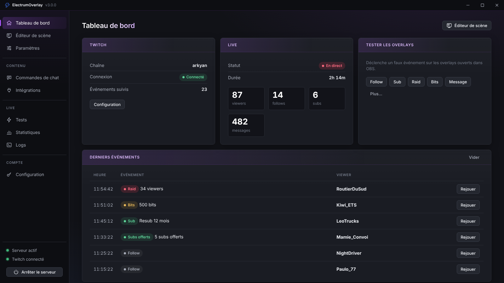
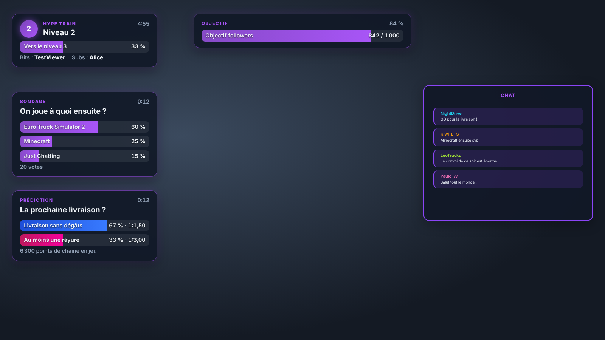
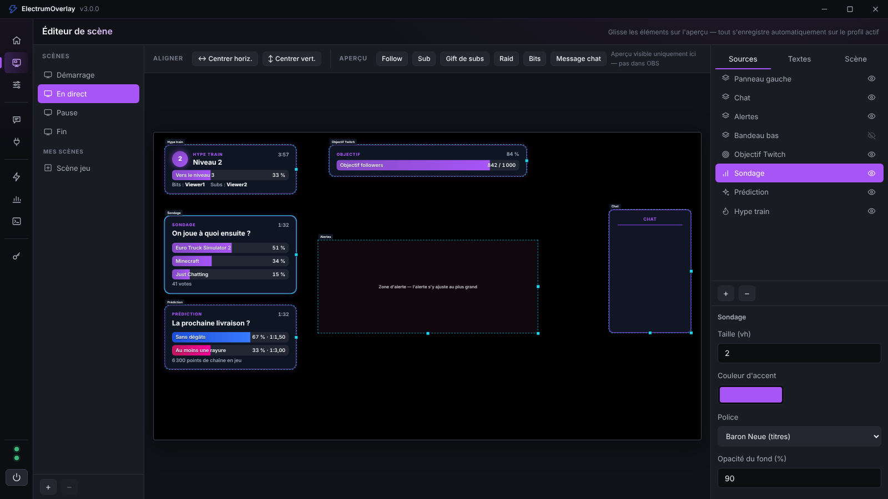
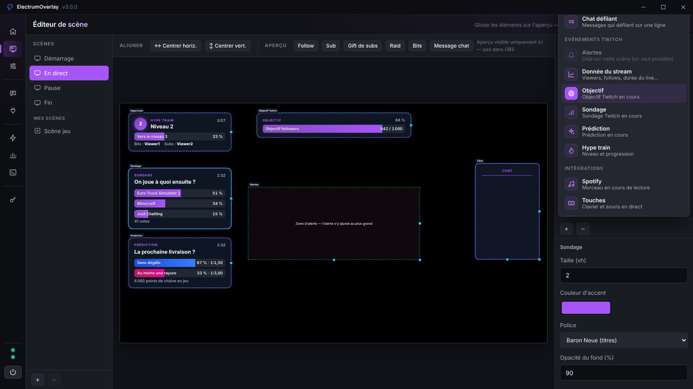
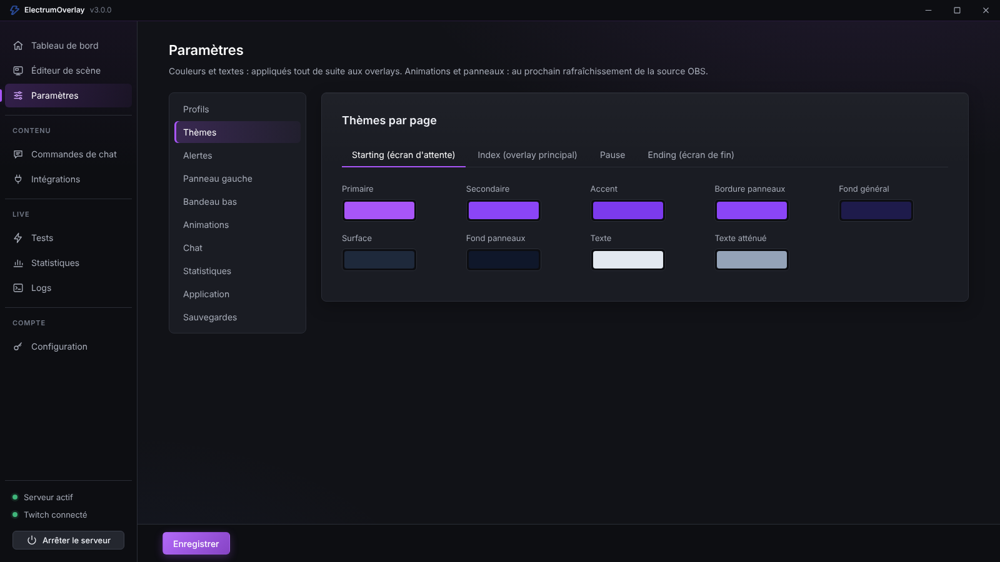

# 🎮 Electrum Overlay — Twitch overlay desktop app

A Windows app that runs your Twitch stream overlays: real-time alerts (follow, sub, raid, bits…), chat, goals, polls, predictions, hype train, live stats, and a scene editor to place everything with the mouse. Everything is managed from the app, no config file editing required.

> Ce readme est également disponible en [français](README.md).



*Screenshots show the French interface. The app is also available in English: Settings › Application › Interface language (English is picked automatically on first launch if Windows isn't in French).*

## 📋 Table of Contents

- [🚀 Features](#-features)
- [📷 Preview](#-preview)
- [📥 Installation](#-installation)
- [🧙 First launch](#-first-launch)
- [📹 Adding the overlays to OBS](#-adding-the-overlays-to-obs)
- [🖥️ Day-to-day use](#️-day-to-day-use)
- [🧩 Scene editor](#-scene-editor)
- [🧪 Testing without going live](#-testing-without-going-live)
- [💾 Backups](#-backups)
- [🤝 Sharing a profile](#-sharing-a-profile)
- [🔄 Updates](#-updates)
- [🚛 TruckyApp integration](#-truckyapp-integration)
- [🎛️ Stream Deck plugin](#️-stream-deck-plugin)
- [🛠️ Development](#️-development)
- [❗ Troubleshooting](#-troubleshooting)

## 🚀 Features

### ✨ Twitch alerts and events
- Follows, subs and resubs, gifted subs, raids, bits, with confetti and a queue so alerts never overlap
- Live **goals**, **polls**, **predictions** and **hype train** on the overlay: they appear when they start, show the result at the end, then disappear
- **Recent events** on the dashboard, with a **Replay** button to re-run an alert you missed
- Direct connection to Twitch (EventSub over WebSocket): no tunnel, no port to open

### 🧩 Scene editor
- Place, resize and tweak every element with the mouse, with a live preview
- About twenty elements: text, images, clock, badges, rotating messages, chat, scrolling chat, alerts, stream data, goal, poll, prediction, hype train, Spotify, keyboard/mouse keys, Trucky panel…
- Four ready-made scenes (Starting, Live, Pause, Ending) plus as many custom scenes as you like

### 🎨 Customization
- **For every kind of stream**: gaming, just chatting, creative or driving simulation; your logo and colors on every screen
- **Custom widgets**: build your own elements in HTML/CSS/JS (Twitch events, stats, theme), import them and place them in the editor; full documentation in the app (Widgets page)
- **Automatic profile per game**: when the Twitch category changes, the theme and scenes follow
- Theme profiles (several ready-made ones), colors per page, animations (particles, stars, meteors, DVD logo), alerts, chat, panels
- Changes apply immediately to the overlays open in OBS
- The app itself takes the main color of the active profile

### 🖥️ A real desktop app
- Lightweight: Rust engine, and the window frees its memory when closed
- Stays in the notification area to keep serving the overlays, even with the window closed
- Interface in English or French (overlays included)
- Optional launch at Windows startup (minimized or not)
- Automatic config backups, one-click restore
- Signed automatic updates
- Custom chat commands, Spotify and TruckyApp integrations, key display, Stream Deck plugin

## 📷 Preview

> An overlay during a stream: hype train, goal, poll, prediction and chat



> The scene editor



> Adding an element



> Settings



> Starting, pause and ending screens


## 📥 Installation

1. Download the latest installer (`ElectrumOverlay_x.x.x_x64-setup.exe`) from the [Releases](https://github.com/Arkyan/ElectrumOverlay/releases) page.
2. Run it and follow the steps.
3. On first launch, the app takes you to the setup wizard.

**Already on version 2.x (Electron)?** Just install 3.0 over it. The old version is uninstalled automatically and your configuration (profiles, sounds, scenes) is kept as is. If the old version has automatic updates enabled, it offers to move to 3.0 on its own.

**Requirements:**
- Windows 10 or 11
- A Twitch account (the one you stream from)
- For TruckyApp (optional): Google Chrome or Microsoft Edge

## 🧙 First launch

On first launch, a welcome screen lets you pick the language, your kind of stream (gaming, just chatting, creative, driving simulation), colors, animations and your logo. Everything can be changed later (**Settings › Application › Run the first-launch assistant again**).

The dashboard then shows a **Getting started** card (style, Twitch, OBS, test alert, scene) that ticks itself off as you go. Less obvious settings have a **?** bubble explaining them.

Then comes the Twitch wizard (**Configuration** in the menu), in three independent parts.

### 1. Twitch application
1. Create an application at [dev.twitch.tv/console/apps](https://dev.twitch.tv/console/apps):
   - **OAuth Redirect URL**: `http://localhost:8080/auth-callback`
   - **Category**: `Application Integration`
   - **Client Type**: `Confidential`
2. Copy the **Client ID** and **Client Secret** into the wizard.

### 2. Twitch authorization
Click **Authorize**: your browser opens Twitch's authorization page. Once approved, the authorized channel shows up in the app and the connection starts right away.

The app asks for access to chat, follows, subs, bits, goals, polls, predictions and hype train. If you authorized the app with an older version, the **Twitch** card on the dashboard shows what is still inactive and offers to authorize again.

### 3. Branding and integrations
Main overlay color, bottom banner texts, and TruckyApp (optional).

## 📹 Adding the overlays to OBS

The dashboard lists all your scenes with a **Copy** button. Add each URL in OBS as a **browser source** at 1920×1080:

| Scene | URL |
|---|---|
| Starting | `http://localhost:8080/starting.html` |
| Live | `http://localhost:8080/` |
| Pause | `http://localhost:8080/pause.html` |
| Ending | `http://localhost:8080/ending.html` |
| Custom scene | `http://localhost:8080/scene/<id>` (URL shown on the dashboard) |

Everything shown on a scene (chat, goal, poll…) is added from the **scene editor**: one OBS source per scene is enough.

`ConfigOBS.json` contains ready-made OBS scenes (Starting, Game, Pause, Ending) to import.

## 🖥️ Day-to-day use

- **Dashboard**: Twitch and stream status (viewers, follows, subs, messages), quick tests, recent events with **Replay**, scene URLs for OBS.
- **Settings**: profiles (with sharing and import), themes, alerts, panels, animations, chat, stats. Also **Application** (language, launch with Windows) and **Backups**.
- **Chat commands**: automatic replies and overlay actions, with permissions and cooldowns.
- **Integrations**: Spotify (now playing), TruckyApp, key display.
- **Logs**: live log viewer, handy when something goes wrong.
- Closing the window keeps the app in the notification area. To stop it: right-click the icon, then **Quit**.

## 🧩 Scene editor

Pick a scene on the left, then add elements with the **+** button: they are grouped by category, with a search box. Click an element to move it, resize it and adjust its properties (size, color, font, opacity…). Everything is saved automatically to the active profile.

The **Goal**, **Poll**, **Prediction** and **Hype train** elements stay invisible on the overlay while nothing is running on Twitch. In the editor, a sample is shown so you can place them.

## 🧪 Testing without going live

The **Tests** page triggers fake events visible on the open overlays: follow, sub, gifted sub, raid, bits, chat message, stream start and end, plus a full goal, poll, prediction and hype train (about fifteen seconds each). Handy to tune the look before going live.

## 💾 Backups

An automatic backup is made once a day when the config has changed (the last 10 are kept), and you can create one at any time from **Settings › Backups**. They include every profile with its sounds and videos. Restoring keeps your current Twitch and Spotify connections and backs up the current state first, so a restore can always be undone.

Location: `%APPDATA%\ElectrumOverlay\backups`.

## 🤝 Sharing a profile

**Settings › Profiles › Share…** creates a `.zip` file with the whole profile: settings (scenes, elements, colors, alerts) and, optionally, the sounds and videos as they are. You can add your name and a description. To import one, **Import…** (or drop the file on the section) shows a preview of its content before adding it.

## 🔄 Updates

The app checks for new versions at startup and regularly afterwards. An update downloads in the background, then a banner on the dashboard (and an entry in the tray icon menu) lets you install it in one click. Updates are signed: the app refuses any file that doesn't come from the project.

## 🚛 TruckyApp integration

For ETS2/ATS streamers: enable the integration in **Integrations** with your TruckyApp user ID (visible in your profile URL on [truckyapp.com](https://truckyapp.com/): `truckyapp.com/user/YOUR_ID`). The **Trucky panel** element then shows your latest job and your company stats.

## 🎛️ Stream Deck plugin

The "ElectrumOverlay Deck" plugin controls the app from your keys:
- **Test alert**: triggers a test follow, sub, raid, bits…
- **Activate a profile**: the icon shows live whether the profile is active
- **Show a panel**: left panel or bottom banner, immediately
- **Live stats**: viewers, follows, subscribers or chat messages on a key

Installation: download `com.electrumvtc.overlay.streamdeck.streamDeckPlugin` from the [Releases](https://github.com/Arkyan/ElectrumOverlay/releases) page and double-click it. The app must be running for the keys to work. To modify the plugin, see `streamdeck-plugin/README.md`.

## 🛠️ Development

### Layout

```
Cargo.toml                 # Rust workspace
crates/electrum-core/      # config, profiles, scene editor, backups (no UI)
crates/electrum-server/    # HTTP + WebSocket server, Twitch EventSub, Spotify, Trucky, app pages
src-tauri/                 # Windows app (window, tray icon, updates, startup)
public/                    # OBS overlays (HTML/CSS/JS)
streamdeck-plugin/         # Stream Deck plugin: manifest, icons, settings pages
crates/electrum-deck/      # Stream Deck plugin (native executable)
xtask/                     # cargo xtask release / plugin
```

### Running from source

Requirements: [Rust](https://rustup.rs/) and the Tauri CLI (once):

```bash
cargo install tauri-cli --version "^2" --locked
```

Run the app:

```bash
cargo tauri dev
```

Run the tests:

```bash
cargo test
```

The app uses the same config as the installed version (`%APPDATA%\ElectrumOverlay\config`). To work on a copy, set `ELECTRUM_CONFIG_DIR` before launching.

Technical details (in French): [docs/MIGRATION-RUST.md](docs/MIGRATION-RUST.md) (architecture, differences from 2.x), [docs/FORMATS.md](docs/FORMATS.md) (file formats), [docs/RELEASE-RUST.md](docs/RELEASE-RUST.md) (publishing a release).

## ❗ Troubleshooting

#### "Port 8080 unavailable"
Another instance is already running: check the notification area, or close the old 2.x version if it is still open.

#### Alerts don't come through
1. On the dashboard, the **Twitch** card should say **Connected**.
2. If it reports a token problem or inactive features, authorize Twitch again from **Configuration**.
3. Check **Logs** for details.

#### An overlay doesn't show the latest changes in OBS
Right-click the browser source › **Properties** › **Refresh cache of current page**.

#### Two-PC streaming
From another PC on the network, the overlays work (replace `localhost` with the address of the PC running the app), but the app, its settings and its APIs are only available from the PC it runs on. The Stream Deck plugin must therefore be on that PC.

---

## 📄 License

MIT, see the `LICENSE` file.

## 🤝 Contributing

Contributions are welcome! See `CONTRIBUTING.md`. In short: fork, create a branch, commit, open a Pull Request.

---

**🎮 Happy streaming! 🚀**
