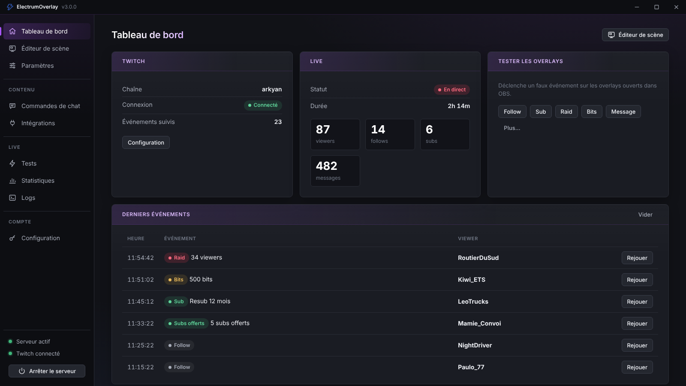
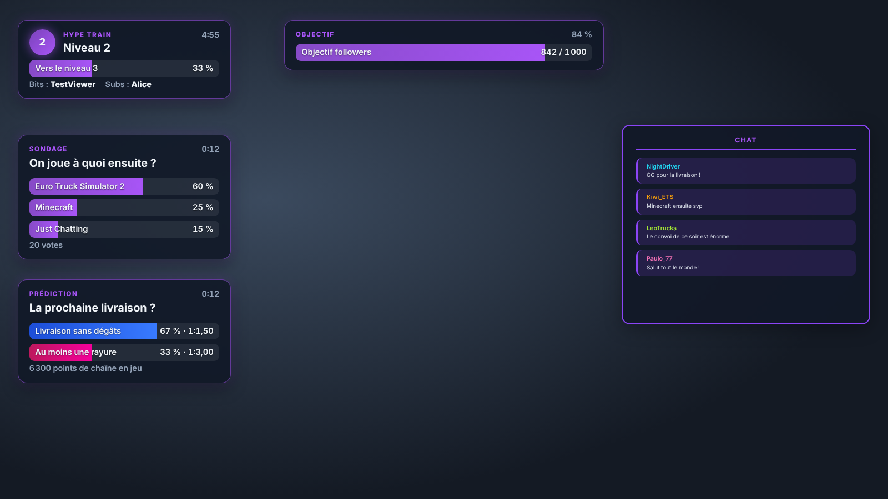
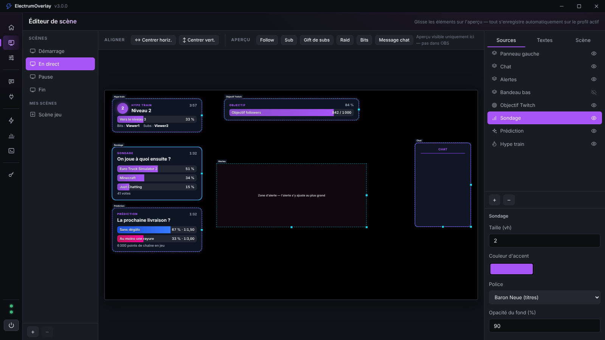
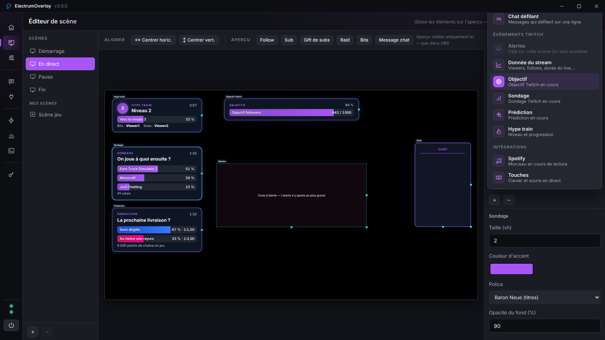
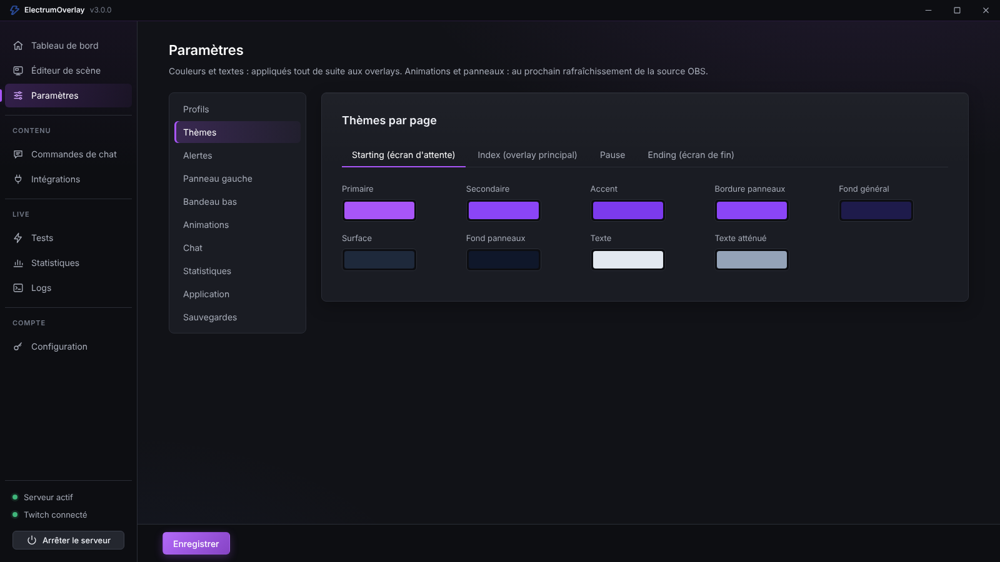

# 🎮 Electrum Overlay — application desktop pour overlay Twitch

Application Windows qui gère tes overlays de stream Twitch : alertes en temps réel (follow, sub, raid, bits…), chat, objectifs, sondages, prédictions, hype train, statistiques du live, et un éditeur de scène pour tout placer à la souris. Tout se pilote depuis l'app, sans toucher à un seul fichier de config.

> This readme is also available in [English](README-EN.md).



## 📋 Table des matières

- [🚀 Fonctionnalités](#-fonctionnalités)
- [📷 Aperçu](#-aperçu)
- [📥 Installation](#-installation)
- [🧙 Premier lancement](#-premier-lancement)
- [📹 Ajouter les overlays dans OBS](#-ajouter-les-overlays-dans-obs)
- [🖥️ Utilisation au quotidien](#️-utilisation-au-quotidien)
- [🧩 Éditeur de scène](#-éditeur-de-scène)
- [🧪 Tester sans être en live](#-tester-sans-être-en-live)
- [💾 Sauvegardes](#-sauvegardes)
- [🤝 Partager un profil](#-partager-un-profil)
- [🔄 Mises à jour](#-mises-à-jour)
- [🚛 Intégration TruckyApp](#-intégration-truckyapp)
- [🎛️ Plugin Stream Deck](#️-plugin-stream-deck)
- [🛠️ Développement](#️-développement)
- [❗ Dépannage](#-dépannage)

## 🚀 Fonctionnalités

### ✨ Alertes et événements Twitch
- Follows, subs et resubs, subs offerts, raids, bits, avec confettis et file d'attente pour éviter les chevauchements
- **Objectifs**, **sondages**, **prédictions** et **hype train** en direct sur l'overlay : ils apparaissent quand ils démarrent, affichent le résultat à la fin, puis disparaissent
- **Derniers événements** sur le tableau de bord, avec un bouton **Rejouer** pour relancer une alerte ratée
- Connexion directe à Twitch (EventSub par WebSocket) : pas de tunnel, pas de port à ouvrir

### 🧩 Éditeur de scène
- Place, redimensionne et règle chaque élément à la souris, avec un aperçu en direct
- Une vingtaine d'éléments : textes, images, horloge, badges, messages rotatifs, chat, chat défilant, alertes, données du stream, objectif, sondage, prédiction, hype train, Spotify, touches clavier/souris, panneau Trucky…
- Quatre scènes prêtes à l'emploi (Démarrage, En direct, Pause, Fin) et autant de scènes personnalisées que tu veux

### 🎨 Personnalisation
- **Pour tous les streams** : jeux, discussion, créatif ou simulation de conduite ; ton logo et tes couleurs sur tous les écrans
- **Widgets personnalisés** : crée tes propres éléments en HTML/CSS/JS (événements Twitch, stats, thème), importe-les et place-les dans l'éditeur ; doc complète dans l'app (page Widgets)
- **Profil automatique selon le jeu** : la catégorie Twitch change, le thème et les scènes suivent
- Profils de thèmes (plusieurs prêts à l'emploi), couleurs par page, animations (particules, étoiles, météores, logo DVD), alertes, chat, panneaux
- Les changements s'appliquent tout de suite aux overlays ouverts dans OBS
- L'app prend la couleur principale du profil actif

### 🖥️ Une vraie application desktop
- Légère : moteur en Rust, la fenêtre libère sa mémoire quand elle est fermée
- Reste dans la zone de notification pour servir les overlays, même fenêtre fermée
- Interface en français ou en anglais (overlays compris)
- Lancement au démarrage de Windows (réduit ou non), au choix
- Sauvegardes automatiques de la config, restauration en un clic
- Mises à jour automatiques et signées
- Commandes de chat personnalisées, intégrations Spotify et TruckyApp, affichage des touches, plugin Stream Deck

## 📷 Aperçu

> Un overlay pendant le live : hype train, objectif, sondage, prédiction et chat



> L'éditeur de scène



> Ajout d'un élément



> Paramètres



> Écrans de démarrage, de pause et de fin


## 📥 Installation

1. Télécharge le dernier installateur (`ElectrumOverlay_x.x.x_x64-setup.exe`) depuis la page [Releases](https://github.com/Arkyan/ElectrumOverlay/releases).
2. Lance-le et suis les étapes.
3. Au premier lancement, l'app t'emmène dans l'assistant de configuration.

**Tu as déjà la version 2.x (Electron) ?** Installe simplement la 3.0 par-dessus. L'ancienne version est désinstallée automatiquement et ta configuration (profils, sons, scènes) est reprise telle quelle. Si l'ancienne version est configurée pour les mises à jour automatiques, elle propose d'elle-même de passer à la 3.0.

**Prérequis :**
- Windows 10 ou 11
- Un compte Twitch (celui qui streame)
- Pour TruckyApp (optionnel) : Google Chrome ou Microsoft Edge

## 🧙 Premier lancement

Au premier lancement, un écran de bienvenue te fait choisir la langue, ton type de stream (jeux, discussion, créatif, simulation de conduite), les couleurs, les animations et ton logo. Tout reste modifiable ensuite (**Paramètres › Application › Relancer l'assistant**).

Le tableau de bord affiche ensuite une carte **Premiers pas** (style, Twitch, OBS, alerte de test, scène) qui se coche toute seule au fur et à mesure. Les réglages moins évidents ont une bulle **?** qui les explique.

Vient ensuite l'assistant Twitch (**Configuration** dans le menu), en trois parties indépendantes.

### 1. Application Twitch
1. Crée une application sur [dev.twitch.tv/console/apps](https://dev.twitch.tv/console/apps) :
   - **URL de redirection OAuth** : `http://localhost:8080/auth-callback`
   - **Catégorie** : `Application Integration`
   - **Type de client** : `Confidential`
2. Copie le **Client ID** et le **Client Secret** dans l'assistant.

### 2. Autorisation Twitch
Clique sur **Autoriser** : ton navigateur s'ouvre sur la page d'autorisation de Twitch. Une fois validé, la chaîne autorisée s'affiche dans l'app et la connexion démarre aussitôt.

L'app demande l'accès au chat, aux follows, aux subs, aux bits, aux objectifs, aux sondages, aux prédictions et au hype train. Si tu as autorisé l'app avec une ancienne version, la carte **Twitch** du tableau de bord indique ce qui reste inactif et propose de ré-autoriser.

### 3. Image de marque et intégrations
Couleur principale des overlays, textes du bandeau du bas, et TruckyApp (optionnel).

## 📹 Ajouter les overlays dans OBS

Le tableau de bord liste toutes tes scènes avec un bouton **Copier**. Ajoute chaque URL dans OBS comme **source navigateur** en 1920×1080 :

| Scène | URL |
|---|---|
| Démarrage | `http://localhost:8080/starting.html` |
| En direct | `http://localhost:8080/` |
| Pause | `http://localhost:8080/pause.html` |
| Fin | `http://localhost:8080/ending.html` |
| Scène personnalisée | `http://localhost:8080/scene/<id>` (URL affichée sur le tableau de bord) |

Tout ce qui s'affiche sur une scène (chat, objectif, sondage…) s'ajoute depuis l'**éditeur de scène** : une seule source OBS par scène suffit.

Le fichier `ConfigOBS.json` contient des scènes OBS déjà prêtes (Starting, Game, Pause, Fin) à importer.

## 🖥️ Utilisation au quotidien

- **Tableau de bord** : état de Twitch et du live (viewers, follows, subs, messages), tests rapides, derniers événements avec **Rejouer**, URLs des scènes pour OBS.
- **Paramètres** : profils (avec partage et import), thèmes, alertes, panneaux, animations, chat, statistiques. On y trouve aussi **Application** (langue, lancement avec Windows) et **Sauvegardes**.
- **Commandes de chat** : réponses automatiques et actions sur l'overlay, avec permissions et délai entre deux utilisations.
- **Intégrations** : Spotify (morceau en cours), TruckyApp, affichage des touches.
- **Logs** : suivi en direct, utile en cas de souci.
- Fermer la fenêtre garde l'app dans la zone de notification. Pour l'arrêter : clic droit sur l'icône, puis **Quitter**.

## 🧩 Éditeur de scène

Choisis une scène à gauche, puis ajoute des éléments avec le bouton **+** : ils sont classés par catégorie, avec une recherche. Clique sur un élément pour le déplacer, le redimensionner et régler ses propriétés (taille, couleur, police, opacité…). Tout s'enregistre automatiquement sur le profil actif.

Les éléments **Objectif**, **Sondage**, **Prédiction** et **Hype train** restent invisibles sur l'overlay tant que rien n'est en cours sur Twitch. Dans l'éditeur, un exemple est affiché pour pouvoir les placer.

## 🧪 Tester sans être en live

La page **Tests** déclenche de faux événements visibles sur les overlays ouverts : follow, sub, sub offert, raid, bits, message de chat, début et fin de live, ainsi qu'un objectif, un sondage, une prédiction et un hype train complets (une quinzaine de secondes chacun). Pratique pour régler le rendu avant d'être en live.

## 💾 Sauvegardes

Une sauvegarde automatique est faite une fois par jour quand la config a changé (les 10 dernières sont gardées), et tu peux en créer à tout moment depuis **Paramètres › Sauvegardes**. Elles contiennent tous les profils avec leurs sons et vidéos. Restaurer garde tes connexions Twitch et Spotify actuelles et sauvegarde d'abord l'état présent : une restauration peut toujours être annulée.

Emplacement : `%APPDATA%\ElectrumOverlay\backups`.

## 🤝 Partager un profil

**Paramètres › Profils › Partager…** crée un fichier `.zip` avec tout le profil : réglages (scènes, éléments, couleurs, alertes) et, en option, les sons et vidéos tels quels. Tu peux y indiquer ton pseudo et une description. Pour l'importer, **Importer…** (ou glisse le fichier sur la section) affiche un aperçu du contenu avant de l'ajouter.

## 🔄 Mises à jour

L'app vérifie les nouvelles versions au démarrage puis régulièrement. Une mise à jour se télécharge en arrière-plan, puis une bannière sur le tableau de bord (et une entrée dans le menu de l'icône) permet de l'installer en un clic. Les mises à jour sont signées : l'app refuse tout fichier qui ne vient pas du projet.

## 🚛 Intégration TruckyApp

Pour les streamers ETS2/ATS : active l'intégration dans **Intégrations** avec ton ID utilisateur TruckyApp (visible dans l'URL de ton profil sur [truckyapp.com](https://truckyapp.com/) : `truckyapp.com/user/TON_ID`). L'élément **Panneau Trucky** affiche alors ton dernier trajet et les statistiques de ta compagnie.

## 🎛️ Plugin Stream Deck

Le plugin « ElectrumOverlay Deck » pilote l'app depuis tes touches :
- **Alerte de test** : déclenche un follow, sub, raid, bits… de test
- **Activer un profil** : l'icône indique en direct si le profil est actif
- **Afficher un panneau** : panneau gauche ou bandeau bas, immédiatement
- **Statistiques en direct** : viewers, follows, abonnés ou messages sur une touche

Installation : télécharge `com.electrumvtc.overlay.streamdeck.streamDeckPlugin` depuis la page [Releases](https://github.com/Arkyan/ElectrumOverlay/releases) et double-clique dessus. L'app doit être lancée pour que les touches fonctionnent. Pour modifier le plugin, voir `streamdeck-plugin/README.md`.

## 🛠️ Développement

### Organisation

```
Cargo.toml                 # workspace Rust
crates/electrum-core/      # config, profils, éditeur de scène, sauvegardes (sans interface)
crates/electrum-server/    # serveur HTTP + WebSocket, Twitch EventSub, Spotify, Trucky, pages de l'app
src-tauri/                 # application Windows (fenêtre, icône, mises à jour, démarrage)
public/                    # overlays OBS (HTML/CSS/JS)
streamdeck-plugin/         # plugin Stream Deck : manifeste, icônes, réglages
crates/electrum-deck/      # plugin Stream Deck (exécutable natif)
xtask/                     # cargo xtask release / plugin
```

### Lancer depuis les sources

Prérequis : [Rust](https://rustup.rs/) et la CLI Tauri (une seule fois) :

```bash
cargo install tauri-cli --version "^2" --locked
```

Lancer l'app :

```bash
cargo tauri dev
```

Lancer les tests :

```bash
cargo test
```

L'app utilise la même config que la version installée (`%APPDATA%\ElectrumOverlay\config`). Pour travailler sur une copie, définis `ELECTRUM_CONFIG_DIR` avant de lancer.

Détails techniques : [docs/MIGRATION-RUST.md](docs/MIGRATION-RUST.md) (architecture, différences avec la 2.x), [docs/FORMATS.md](docs/FORMATS.md) (formats de fichiers), [docs/RELEASE-RUST.md](docs/RELEASE-RUST.md) (publier une version).

## ❗ Dépannage

#### « Port 8080 indisponible »
Une autre instance tourne déjà : regarde la zone de notification, ou ferme l'ancienne version 2.x si elle est encore ouverte.

#### Les alertes n'arrivent pas
1. Sur le tableau de bord, la carte **Twitch** doit indiquer **Connecté**.
2. Si elle indique un problème de token ou des fonctions inactives, ré-autorise Twitch depuis **Configuration**.
3. Consulte **Logs** pour le détail.

#### Un overlay n'affiche pas les dernières modifications dans OBS
Clic droit sur la source navigateur › **Propriétés** › **Actualiser le cache de la page actuelle**.

#### Stream à deux PC
Depuis un autre PC du réseau, les overlays s'affichent (remplace `localhost` par l'adresse du PC qui fait tourner l'app), mais l'app, ses réglages et ses API ne sont accessibles que depuis le PC où elle tourne. Le plugin Stream Deck doit donc être sur ce PC.

---

## 📄 Licence

MIT, voir le fichier `LICENSE`.

## 🤝 Contribution

Les contributions sont les bienvenues ! Voir `CONTRIBUTING.md`. En résumé : forke, crée une branche, commite, ouvre une Pull Request.

---

**🎮 Bon streaming ! 🚀**
